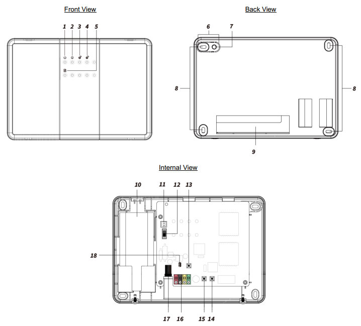
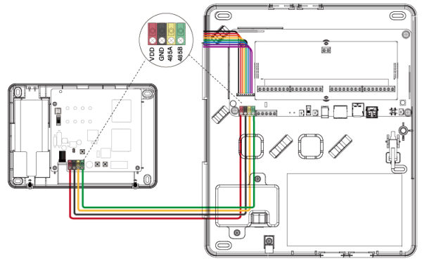
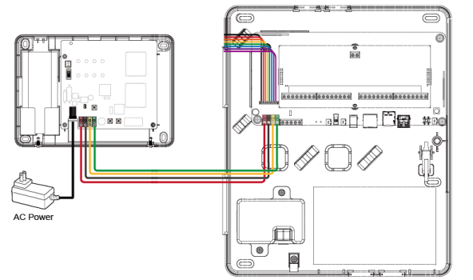
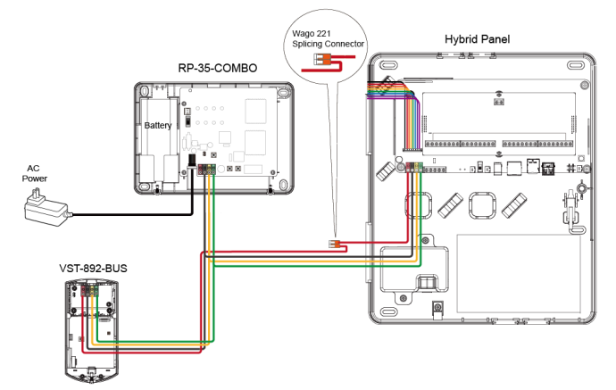
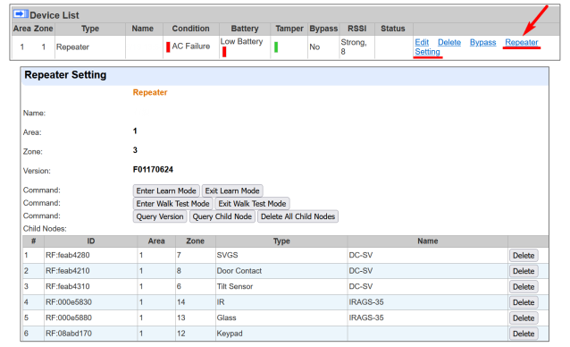
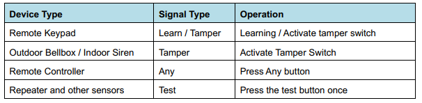
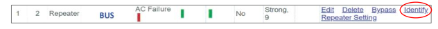

# VESTA-475

RP-35-HR-18-COMBO

<figure><figcaption></figcaption></figure>

The RP-35-Combo Hybrid Repeater is designed to work with the Hybrid Panel, especially in locations where RF signals are easily interfered with.

When it receives RF signals from devices, the RP-35-Combo retransmits them to the Hybrid Panel via BUS. If BUS communication fails, it will retransmit the signals via SF1 as a backup.

## **Identifying the Parts**

<figure><figcaption></figcaption></figure>

**1. Power LED (Green)**

&#x20;   **On**–Powered by a Power Adapter or Rechargeable Battery

&#x20;   **Flash**(1 flash every second)–Rechargeable Battery low on power&#x20;

**2. Mode LED (Yellow)**

&#x20;    **Slow Flash**(1 flash every 2 seconds)–When in Learning Device Mode operated from Local     Webpage

&#x20;   **Flash**(1 flash every second)–In Walk Test Mode **On**–In Learning Panel Mode (Wireless operation)

**3. Transmission: Receive LED (Blue)**

&#x20;   The Blue LED lights up when the Repeater receives a signal transmission

**4. Transmission: Transmit LED (Red)**

&#x20;   The Red LED lights up when the Repeater transmits a signal.

5. **BUS LED (Blue)**

&#x20;     On – Repeater connected to the Control Panel via BUS connection&#x20;

&#x20;     10 Flashes – User clicks “Identify” from the Panel webpage to locate RP-35-Combo 1 in the BUS network

**6. Breakaway Area**

&#x20;    When the Repeater is forcibly removed from the mounting location, the area will be detached, causing the tamper switch to be activated.

**7. Tamper Switch (For Wall Mounting)**

&#x20;   The Repeater is protected by the tamper switch against any unauthorized removal from the mounting location.

**8. Mounting Holes**&#x20;

**9. Wiring Hole**

**10. Rechargeable Battery Pack**

**11. Battery Connection Terminal**

&#x20;   For connecting the rechargeable battery pack to the PCB.

**12. Battery Switch**&#x20;

**13. Tamper Switch**

**14. RF Test Button (SW2)**

**15. BUS Test Button (SW3)**

**16. Pluggable BUS Terminal**&#x20;

**17. DC jack**

**18. Terminal Resistor Jumper Switch (J3)**

On each BUS network, enable the terminal resistor jumpers at both endpoints (the two farthest nodes) to prevent signal reflection and ensure stable communication. If repeater is one of the endpoints, set its terminal resistor jumper switch to ON.

* Turn the jumper to OFF by removing the jumper link or “parking” the jumper link on one pin. - Turn the jumper to ON by resting the jumper link on both pins.

## **Power Supply**

### **Power Adapter Application:**

A DC 12V 1A output Power Adapter is used to power the Repeater.

### **Rechargeable Battery:**

In addition to the adapter, there is a rechargeable battery inside the Repeater, which serves as a back-up power in case of a power failure.

When the Power Adapter is plugged into the DC power jack, slide the Battery Switch to the ON position so the Power Adapter supplies power to the Repeater and at the same time recharges the battery. It takes approximately 32 hours to fully charge the battery.

When the Power Adapter is unplugged, the Repeater will be powered by the rechargeable battery.

### **AC Failure / AC Restore / Low Battery Detection:**

The Repeater will send an AC Failure signal to the Control Panel when the Power Adapter is unplugged for 30-60 seconds. When the Power Adapter is plugged in again for 30-60 seconds, the Repeater will send an AC Restore signal to the Control Panel.

The Repeater can detect the battery voltage. When the battery voltage is low, the Repeater will send a Low Battery signal to the Control Panel, the Green LED will flash to indicate low battery status. When the power adaptor is plugged in again, low battery status will be removed.

### **Caution**

Wiring of the Repeater should only be performed by certified technicians with proper knowledge and training in electric equipment.

Before installation or any maintenance work, make sure the power supply has been disconnected.

### **Connection to the Hybrid Panel**

Before connecting the Repeater to the system bus, please switch the power off.

To assist with cable connections, the terminal blocks on each BUS system module are color- coded.

>)


&#x20;The pluggable design of BUS terminal blocks improves upon installation efficiency. Before wiring, you can remove the terminal blocks from the PCB board for ease of use, and plug in again after wiring.

After unplugging the terminal, when re-installing the terminal back to the board, make sure to install the terminal in the same direction to avoid potential hazards.


&#x20;Incorrect connections will result in failure or improper operation. Inspect wiring and ensure proper connections before applying power.

The Hybrid Panel can supply 13.5VDC to the Repeater via the BUS wired connection.

<figure><figcaption></figcaption></figure>

The Repeater can alternatively be powered by a 12VDC / 1A power adapter or its backup battery.
 

If both the BUS power and the power adapter are connected, the Repeater automatically selects
\
the power source with the higher voltage.

<figure><figcaption></figcaption></figure>

When connecting the Repeater to the Panel in the presence of the power adapter, user can also
\
bypass the Panel’s red VDD terminal using a WAGO 221 Splicing Connector to increase wiring
\
efficiency, reliability, and maintainability.
\
Connect the Panel’s VDD line through the WAGO connector to the next BUS device that is powered
\
by the Panel.

<figure><figcaption></figcaption></figure>

## &#x20;**Learn Repeater into the Control Panel**

**Wireless Operation**

**Step 1** On the Control Panel webpage, click “Learning”**to open the learning page, then click**“Start” to enter learning mode.

**Step 2** Press and hold the Repeater’s  RF test button (SW2) for **3 seconds**until you hear one long beep, then release. The **yellow LED**will turn on, indicating learning mode.

**Step 3** On the Panel webpage, click **Add**to include the Repeater into the Panel.

**Successful Learning:** If the Repeater receives an acknowledge signal from the Control Panel within
&#x20;60 seconds, learning is successful. The Blue LED will light up for 1 second with a long beep as
&#x20;the Repeater leaves learning mode.
\
**Unsuccessful Learning:** If the Repeater does not receive an acknowledge signal from the Control
\
Panel within 60 seconds, learning has failed. Repeat steps 1-2 to retry


The Repeater stays in learning mode for **up to 60 seconds**or until learning succeeds.

Pressing the button again for 3 seconds exits learning mode immediately with two short beeps.


**Wired Operation:**

In addition to the wireless method described above, the repeater can also be added to the panel via wired connection.

**Step 1** After connecting the repeater to the Hybrid Panel through BUS wiring, power on the Panel, and then power on the repeater.

**Step 2** On the Control Panel webpage, click “Learning”**to open the learning page, then click**“Start” to enter learning mode.

**Step 3** The Repeater will be displayed on the panel webpage if the BUS connection is successful. **Step 4**Click **Add**to include the Repeater into the Panel.

### **Walk Test with the Control Panel**

Conduct Walk Test to make sure the Repeater is able to communicate with the Panel after it is learned-in.

**Wireless Walk Test**

**Step 1** When the Repeater is not connected via BUS, put the Control Panel into **Walk Test**mode. **Step 2** Press the RF test button (SW2) on the Repeater to transmit a test signal to the Control Panel.

**Step 3** When the Panel receives the test signal, it will beep once and display the Repeater’s information accordingly.


If there is no response from the Panel after the press of test button, it means the Panel did not receive the test signal from the device. Please check whether the Repeater is within signal range of the Panel.


**Wired Walk Test**

**Step 1** When the Repeater is connected via BUS, put the Control Panel into **Walk Test**mode.&#x20;

&#x20;**Step  2**Press the BUS test button (SW3) on the Repeater to transmit a test signal to the Control

Panel.

**Step 3** When the Panel receives the test signal, it will beep once and display the Repeater’s information accordingly on the top of the device list.


&#x20;If there is no response from the Panel after the press of test button, it means the Panel did not receive the test signal from the device. Please check whether the Repeater is connected properly to the Panel within appropriate wiring distance.


### &#x20;**Repeater Setting (Local Webpage)**

After the repeater is learned into the Control Panel, proceed to program repeater setting on the Panel’s webpage.

Go to the **Repeater Setting**on Panel’s webpage.

<figure><figcaption></figcaption></figure>

### **Learning Device/Repeater into the Repeater**

Make sure the devices/repeaters are already learned into the Control Panel before learning them into the Repeater.

**Step 1** On the Repeater setting page, click“**Enter Learn Mode**.”The repeater will emit 1 long beep and enter device learning mode. The Repeater’s Yellow LED will start to flash slowly (1 flash every 2 seconds).

**Step 2** Refer to individual device manual to send following signal:

<figure><figcaption></figcaption></figure>

If the Repeater receives a learn code from a new device, it will emit 1 long beep and the Blue LED will light up for 1 second to indicate successful learning.

If the Repeater receives a learn code from a device already learnt into the Repeater, it will emit 2 beeps and the Blue LED will light up for 1 second.

➢ **A maximum of 60 devices (including repeaters) can be learnt into a Repeater, and up to 8 PIR cameras are supported. If the user attempts to learn in a 61st device, the Repeater will emit 4 beeps.**

➢ **SFV voice extenders are Not supported by the Repeater.**

➢ **Please do not cross-learn the Repeaters, e.g. Learning Repeater A into Repeater B and learning Repeater B into Repeater A.**

➢ **All repeaters will have to be learnt into the Control Panel.**

**Step 3** Click“**Exit Learn Mode**.”The repeater will emit 1 long beep and exit device learning mode. The yellow LED will turn off.

Alternatively, the repeater will automatically exit device learning mode after 5 minutes.

### **Conducting Walk Test**

Learnt-in devices can check for its signal range with the Repeater if the Repeater enters Walk Test Mode.

**Step 1** On the Repeater setting page, click“**Enter Walk Test Mode**.”The Repeater will enter Walk Test mode, as indicated by 1 long beep. The Yellow LED will start to flash once every second.

**Step 2** When the Repeater receives a signal from the learnt-in device, it will emit a long beep and the Blue LED will light up for 1 second. The signal will then be retransmitted as the Red LED lights up for 1 second.

**Step 3** Click“**Exit Walk Test Mode**.”The repeater will exit Walk Test mode, as indicated by 1 long beep. The yellow LED stops flashing.

Alternatively, the repeater will automatically exit Walk Test mode after 5 minutes.

### **Query Child Node**

After the devices/repeaters are learned into the Repeater, click“**Query Child Node.**”The learned in devices/repeaters will be displayed one by one in the Child Node list.

**If a child node device is not yet learned into the Control Panel, “Unknown Type” and“Device Not Existed” will be displayed. Make sure to learn the device into the Control Panel for the Panel to recognize it.**

>) >)

### **Delete Device/Repeaters from the Repeater**

**Delete All**: Click“**Delete All Child Nodes**”.All previously learned-in devices/repeaters will be removed.

**Delete One Device**: Click the **Delete**button at the end of the device/repeater entry you wish to delete from the Device List. The device/repeater will then be deleted.

### **RP Connection Map (Home Portal Server: Installer Web/App)**

Please log in to Home Portal Server with the **Installer account**. Go to **Main Page**> **Device List**. If the Panel has learned in RP-32 Repeater(s), the **RP Connection Map icon**   will be displayed besides the Device List header.

>)

Clicking on the icon will pop up the RP Connection Map.

>)

The **Panel**, the **Repeater/RF Devices**, and **the RF Device(s) that is/are connected to Repeater**will be displayed from the left column to the right column on the map.

If no devices are connected to any Repeater, only two columns (Panel, Repeater/Devices) will be shown on the map.

&#x20;Zoom in and Zoom out: Use the Zoom in + and Zoom out - buttons on the lower right, or scroll with the mouse wheel to zoom in and out on the Map.

Highlight: Clicking any Repeater or device icon (except the panel) will highlight the connection lines and related items. Clicking the Panel icon will return to default view.

Refresh: Click to get the latest Repeater connection status.

Edit: Click to enter Edit Mode, and then click an individual Repeater icon to access the settings page for that repeater.

➢ **Edit Mode**: In Edit Mode, only Repeater icons are highlighted. Click on a Repeater icon to access its settings page.

>)

➢ **Repeater Setting Page**: The Repeater Setting page lists the devices that are connected to the repeater. You can add / delete devices by clicking / .

>)

**Add Device**: after clicking  + , the Add Device list will pop up, displaying devices that are not connected to any Repeater and are available to be added to the current Repeater. Select the device(s) by checking the box(es), then click Submit to add the selected device(s) to the Repeater.

>)

**Remove Device**: after clicking , the Delete Device list will pop up, displaying devices that are connected to the current Repeater. Select the device(s) by checking the box(es), then click Delete to remove the selected device(s) from the Repeater.

>)

After exiting Edit mode, the third column of devices connected to the Repeater(s) will be updated immediately.

### **Supervisory Signal**

The Repeater is supervised by sending a periodic supervision signal to the Control Panel. When the Control Panel fails to receive a supervision signal within the preprogrammed period, a fault will be indicated by the Control Panel.

### Identification

The Identify function helps locate a BUS device in the BUS-wired system. This function is p
\
useful in large installations with many BUS devices, helping installers distinguish one device from
\
To locate the Repeater in the BUS system:


On the Panel webpage, click Identify in the device list corresponding to the Repeater.

<figure><figcaption></figcaption></figure>


\
\- If the Repeater receives the signal from the Panel, a success message will appear on the
\
and the Repeater’s BUS LED will flash 10 times to indicate its location.
\
\- If the Repeater does not receive the signal, a timeout message will appear on the webpa
\
that the Repeater is properly connected to the Panel within appropriate wiring distance

### **Tamper Protection**

The RP-35-Combo has two Tamper Switches; each comes with a different function.

The Tamper Switch for case cover is located at the front of the board. It is in normal position when the case is closed. Tamper violation happens when the case is opened where Tamper Switch is released (Tamper Opened).

The Tamper Switch for wall mounting is located at the back of the board. It is in normal position when the Repeater is well mounted on the wall. Tamper violation happens when the Repeater is forcibly removed from the mounting location; the breakaway area will be detached, causing the tamper switch to be activated.

The tamper is considered as triggered if any one of the tamper is opened. The Tamper is only considered restored when both tampers are in closed state.

### **Operation**

The RP-35-Combo receives RF signals from devices (Receive LED lights Blue) and retransmits them to the Control Panel via BUS (or via SF1 as a backup). The Transmit LED will light up accordingly.

The RP-35-Combo also receives signals from the Control Panel (via BUS or SF1 as a backup) and then retransmits them to the corresponding device(s) via RF.


When RP-35-Combo is connected to Panel via BUS, it will communicate with the Panel primarily through **BUS**. If BUS communication fails, it will automatically switch to **SF1** as a backup.

When the RP-35-Combo is **not**connected to Panel via BUS, it will communication with the Panel using **SF1 only**.


### **Deployment Guidelines**

➢ All Devices and Repeaters must be learnt into the Control Panel for the panel to recognize them. Each device must be learnt into the Repeater that receives and relays its signal.

➢ If a device is within an acceptable range for Control Panel to receive its signal, it is strongly recommended to learn the device into the Control Panel directly instead of into the Repeater.

➢ When employing multiple repeaters, please learn each device into the closest repeater in its

operation area. Avoid learning a device into multiple repeaters.

➢ It is recommended to link only a single layer of repeaters. If deployment requires linking repeaters to form a transmission relay, use no more than two layers. Only the MDC-5, IR-35, and SD-32 models are compatible with this setup."

➢ Maintain a distance between repeaters and the Control Panel to prevent cross signaling.

➢ As the RP-35-Combo is designed to communicate with the Panel primarily through **BUS**and automatically switch to **SF1**as a backup, the **RF communication range between the Panel and the Repeater, as well as between Repeaters, should be carefully observed**.

### **Single Repeater**

In the example below when one repeater is used:

⚫ Repeater A should be learned into the Control Panel.

⚫ Device 2 should be learned into Repeater A for Repeater A to receive and relay its signals. Device 2 should also be learned into the Control Panel.

⚫ For Device1 that is within acceptable range for Control Panel to receive its signal, it is strongly recommended to learn Device1 into the Panel directly instead of into the

Repeater Example

>)

**Multiple Repeaters**

In Example1 when multiple repeaters are used:

⚫ All Repeaters (A/B/C/D) and Devices (1/2/3/4) should be learned into the Control Panel.

⚫ Devices (1/2/3/4) need to be learned into the respective repeaters in their operation areas. Device 1 into Repeater A,

Device 2 into Repeater B,

Device 3 into Repeater C,&#x20;

Device 4 into Repeater D.

In Example 2, where the Device 5 is located between the RF coverage areas of two Repeaters, please choose **one Repeater only**to learn the Device 5 to prevent signal traffic. **Do Not**learn a device into more than one repeater.

⚫ Repeater E and F should be learned into the Control Panel.

⚫ Device 5 has to be learned into One Repeater Only (**either Repeater E only or Repeater F only**). Do NOT learn Device 5 into both repeaters.

⚫ Device 5 should also be learned into the Control Panel.

>) >)

When linking repeaters to form a transmission replay, please use no more than two layers of repeaters. Only the MDC-5, IR-35, and SD-32 models are compatible with this configuration.

In the Example 3 below (Device to B to A to Control Panel), Repeater A, Repeater B, and the Device must all be learned into the Control Panel.

Learn the Device into its closest repeater (Repeater B), and learn Repeater B into Repeater A. (Do not learn Repeater A into Repeater B.)

>)

### **How to Mount the Repeater**

The Repeater can be mounted on the wall. Follow the steps below to mount it:

⚫ Loosen the bottom fixing screws and remove the front cover.

⚫ Using the holes of the base as a template, mark the drilling holes on the wall.⚫ Drill holes on the marked location on the wall. Insert wall plugs if required.

⚫ Screw the base onto the mounting location.

⚫ Re-place the front cover and tighten the bottom fixing screws.

>)

