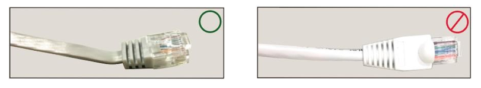

# VESTA-515

AUX-PS-DC

This guide provides instructions on installing AUX-PS-DC/DC to Qallmax/TouchPanel-3. The unit is integrated with a back plate for easy installation.

<figure><figcaption></figcaption></figure>

## **Installation Guide**

To install AUX-PS:

1. Loosen the two fixing screws and separate the speaker cover from AUX-PS.
2. Route the Ethernet cable through the AUX-PS opening.


_**Use an Ethernet cable without the RJ45 plastic housing.** Ensure that both the cable and RJ45 connector can pass through the wiring hole and AUX-PS opening._


<figure><figcaption></figcaption></figure>

3. Route the power cable through the AUX-PS opening, then connect and secure the two power wires to the AUX-PS terminals. For **AUX-PS-DC**, connect the **positive** and **negative** output wires from a regulated DC power source to the **V+** and **V-** terminals respectively.
4. Secure the AUX-PS-integrated back plate to the wall using five screws.

<figure><figcaption></figcaption></figure>

5. Open the rear access cover on TouchPanel-3. Connect the RJ45 connector to the Ethernet Port and the USB-C cable to the USB-C Port.

<figure><figcaption></figcaption></figure>

6. Replace and secure the rear access cover, then attach the upper part of TouchPanel-3 to upper part of the back plate.
7. Place the USB-C cable in the cable hook, and neatly arrange the Ethernet cable and power cable.
8. Close the lower part of TouchPanel-3.
9. Re-attach speaker cover to the back plate.
10. Fasten the two fixing screws.
