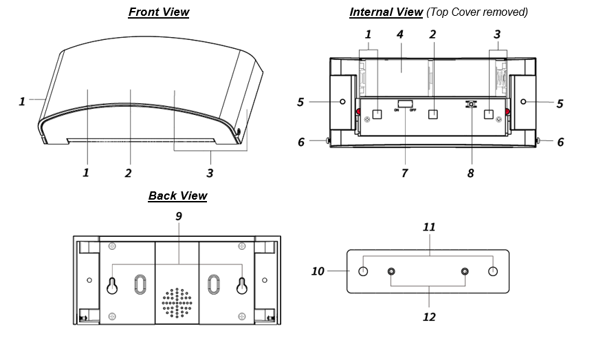
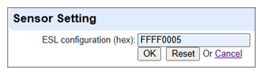
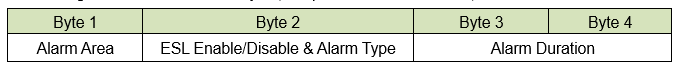
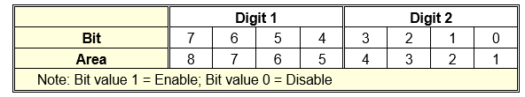
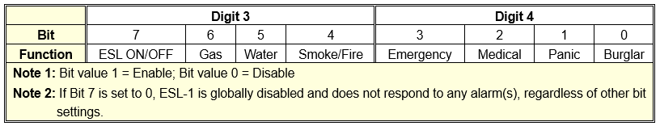
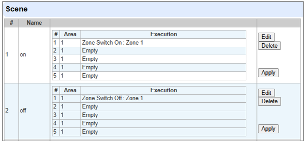
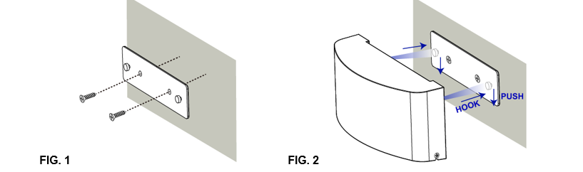
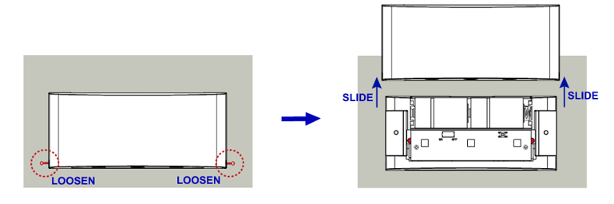

# VESTA-516

ESL-1 (White)

## Emergency Strobe Light, White colour

<figure><figcaption></figcaption></figure>

## Introduction

The Emergency Strobe Light ESL-1 is a battery-operated emergency strobe light that provides visual alert by flashing its LEDs when activated.

The Emergency Strobe Light can be configured to respond to the designated alarm(s) raised within the programmed Area(s). In addition, ESL-1 can be turned on / off remotely by the Control Panel.

## Parts Identification

<figure><figcaption></figcaption></figure>

1. **LED 1**
2. **LED 2**
3. **LED 3**
4. **Battery Compartment**

&#x20;      ESL-1 is powered by two 1.5V D-Cell alkaline batteries.

5. **Mounting Holes**
6. **Fixing Screws**
7. **Power Switch**
8. **Learn Button**
9. **Hook Holes**
10. **Mounting Bracket**
11. **Hooks**
12. **Mounting Holes**

## Features

### Battery and Low Battery Detection

The Emergency Strobe Light is powered by two 1.5V D-Cell Alkaline batteries. It features low battery detection and transmits low battery signals along with regular signal transmissions when low battery voltage is detected.

When changing the batteries, press the learn button several times after removing the old batteries to fully drain the residual power before inserting new ones.

### Supervision

After learned in, ESL-1 transmits a supervision signal to the Control Panel every 15-18 minutes.

When the Panel does not receive the supervision signal within the preset period, it will indicate a fault.

### Operating Behavior

#### Alarm Activation

When an alarm is triggered, ESL-1 flashes once every 2 seconds for a duration set for alarm duration (refer to XML Command Setting for details).

#### Manual Control

Users can remotely turn ESL-1 on or off via scene settings.

## Getting Started



### Remove the top cover

Loosen the fixing screws on the short sides and remove the top cover by sliding it upwards.



### Insert the batteries

Insert the batteries according to the polarity and slide the power switch to ON to power ESL-1 on. All LEDs will flash once together.



### Put the Control Panel in Learn Mode

Refer to Control Panel manual to put the Control Panel in Learn Mode.



### Send a learn signal

Press the learn button once to transmit a learn signal. LED 2 will turn on for 1 minute.



### Complete the learning process

Refer to Control Panel manual to complete the learning process.

The Control Panel will transmit an acknowledgement signal. When ESL-1 receives the signal, all LEDs will flash twice to indicate successful reception.



## Remote Configuration

The Emergency Strobe Light can be configured to activate for a defined duration in response to specified alarm(s) raised within the programmed Area(s).

Remote configuration of the Emergency Strobe Light is supported via the Control Panel webpage or SmartHomeSec


The triggering device’s settings also control ESL-1’s behavior. It will not activate if a device’s Attribute is set to “**Silent Alarm**” in the Panel, regardless of the Area and Alarm Type settings.


### Control Panel Webpage



#### Open the Device Edit page

After successful learning ESL-1, navigate to the Emergency Strobe Light’s **Device Edit** page on Panel webpage.

<figure><figcaption></figcaption></figure>



#### Enter the ESL configuration

Enter an **8-digit hexadecimal (Hex) value** (i.e., 4 bytes) into ESL Configuration, then click **OK** to apply the setting. Please see the table below for configuration details.

ESL-1’s all LEDs will flash once upon receiving the configuration from the Panel.



### ESL Configuration

The setting value consists of four bytes, 8 alphanumeric characters, in Hex value.

<figure><figcaption></figcaption></figure>

<mark style="color:$primary;">**Byte 1 (Digits 1+2): Alarm Area**</mark>

ESL-1 can be configured to respond to alarms raised in one or multiple Areas.

<figure><figcaption></figcaption></figure>

**Example 1: One Area**

To respond to alarms in Area 6 only, enter **20** (the Hex value for binary 0010 0000) as digits 1-2.

**Example 2: Multiple Areas**

To respond to alarms in Areas 1 and 3, enter **05** (the Hex value for binary 0000 0101).

**Example 3: All Areas**

To respond to alarms raised in all Areas, enter **FF** (the Hex value for binary 1111 1111).


For ESL-1 to respond, ensure the Attribute for triggering devices in the programmed Area(s) is not set to “**Silent Alarm**”.


<mark style="color:$primary;">**Byte 2 (Digits 3+4): ESL Enable/Disable & Alarm Type**</mark>

Byte 2 controls the ESL Enable/Disable function and defines the alarm type(s) to which it responds.

<figure><figcaption></figcaption></figure>

**Example**

To enable ESL-1 for Smoke/Fire alarms, medical alarms and burglar alarms, enter **95** (the Hex value for binary 1001 0101) as digits 3-4.

<mark style="color:$primary;">**Byte 3 (Digits 5+6) + Byte 4 (Digits 7+8): Alarm Duration (0-65535 seconds)**</mark>

These two bytes define the alarm duration.

* The value must be entered as a **4-digit hexadecimal number (0000-FFFF)** converted from a decimal value between 0 and 65535, corresponding to the desired alarm duration.
* Add leading zero(s) if necessary to ensure a full four-digit entry.


The Panel’s Alarm Length setting also controls the alarm duration (up to 15 minutes). The ESL-1 flashing will stop as soon as either timer expires.


**Example: Set the alarm to 60 seconds**



#### Convert to Hex

60 seconds (Decimal) = **3C** (Hexadecimal).



#### Enter the value

Add leading zeros to format as **003C** and enter as digits 5-8.



**Example Scenario**

When **FFFF012C** is entered in ESL Configuration, ESL-1 will:

* Respond to **Gas, Water, Smoke/Fire, Emergency, Medical, Panic, and Burglar alarms** raised in **ALL Areas** for a duration of **300** seconds (5 minutes).

### Remote Control

Users can remotely turn ESL-1 on or off via **System Setting >** **Scene**.





#### Click Edit

Click **Edit**.



#### Select the Area

Select the **Area** to which ESL-1 is assigned.



#### Configure Zone Switch On

Select **Zone Switch On** and choose the **Zone** **number** of ESL-1 under Execution; click **OK**. The **Apply** button will appear.



#### Apply the setting

Click **Apply**. ESL-1 will flash every 2 seconds for 15 minutes.

<figure><figcaption></figcaption></figure>







#### Click Edit

Click **Edit**.



#### Select the Area

Select the **Area** to which ESL-1 is assigned.



#### Configure Zone Switch Off

Select **Zone Switch Off** and choose the **Zone** **number** of ESL-1 under Execution; click **OK**. The **Apply** button will appear.



#### Apply the setting

Click **Apply**. ESL-1 will turn off.





## Installation

### Installation Guideline

* ESL-1 is designed to be mounted on a flat surface with the fixing screws and wall plugs provided.
* ESL-1 should be mounted on the wall using the mounting bracket.
* Before installation, perform Walk Test at the intended installation location to verify stable RF communication.

### Installation

A mounting bracket is provided for mounting the Emergency Strobe Light.



## Mount the mounting bracket

Use the two mounting holes on the mounting bracket to mount and screw the mounting bracket onto the wall (FIG. 1).



## Secure ESL-1 to the bracket

Hook ESL-1 onto the mounting bracket and push it downwards to firmly secure it in place (FIG. 2).

<figure><figcaption></figcaption></figure>



### Battery / Top Cover Replacement



## Loosen the fixing screws

Loosen the bottom fixing screws that secure the top cover to the device.



## Slide the top cover upwards

Slide the top cover upwards (to reveal the battery compartment). This will allow access for battery as well as top cover replacement.

<figure><figcaption></figcaption></figure>



## Factory Reset

The Emergency Strobe Light can be reset to clear all the programmed settings.



#### Remove the top cover

Loosen the fixing screws and remove the top cover.



#### Turn off the device

Slide the power switch to OFF to turn off the device and press Learn Button several times to fully drain the residual power.



#### Turn on the device while holding Learn Button

Press and hold Learn Button while sliding the battery switch to ON.



#### Wait for the reset confirmation

Continue to hold Learn Button for about 7 seconds until all LEDs flash three times. The previously configured settings are now cleared.


